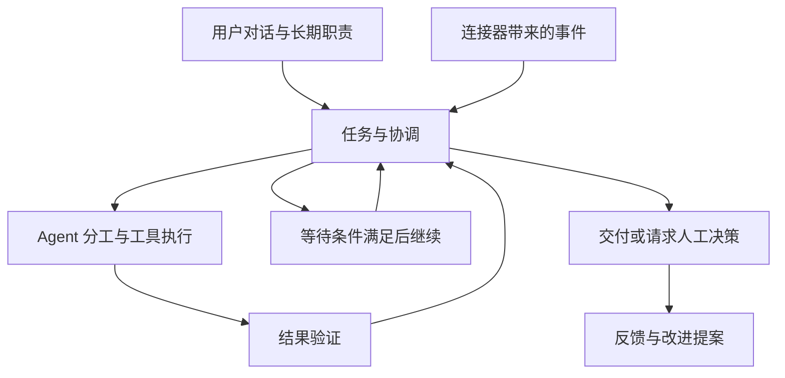

  

<h1 align="center">Oarvia · 同舟</h1>

团队工作空间里的 Super Agent

Oarvia 承接团队的长期目标，持续关注工作环境中的变化，主动跟进问题，按需组织多个 Agent 协作，把事情推进到可验证的交付。

用户通过对话交代目标、补充要求和作出决定。Oarvia 在后台保存任务进展与等待条件，通过连接器获取事件、调用工具，并在条件满足时继续工作。

## 产品定位

团队可以把一项具体任务交给 Oarvia，也可以让它长期负责一类工作。

> 持续维护这个产品。关注 GitHub 和用户反馈渠道，调查有价值的问题，安排修复与验证，跟进评审和发布条件。涉及产品取舍、架构调整或超出授权范围时，带着证据找负责人决定。

首批场景拟面向开源维护者与小型研发团队。任务、职责与协作机制按通用团队工作设计，后续可以扩展到项目推进、客户跟进和业务运营。

## 核心能力规划

| 能力          | 产品行为                                                                   |
| ------------- | -------------------------------------------------------------------------- |
| 对话协作      | 接收目标、回答进度、纳入补充要求，并向负责人请求必要的决策。               |
| 长期职责      | 保存关注来源、触发条件、完成标准、授权范围和预算，持续接收新工作。         |
| 主动跟进      | 监听事件、截止时间与等待条件，跟进 CI、评审、审批和外部依赖。              |
| 多 Agent 协作 | 根据任务安排调查、实现、验证等分工，管理依赖并汇总交付。                   |
| 连接器        | 接入对话软件、代码仓库、工单、监控与执行环境，按权限读取和操作。           |
| 持续执行      | 保存任务状态、执行证据和产物，支持暂停、取消、接管与故障后的恢复。         |
| 结果验证      | 按任务完成标准检查结果，记录仍未解决的问题与需要人工确认的事项。           |
| 复盘改进      | 从执行记录与人工反馈中提出技能、上下文或工具改进，经验证和相应确认后启用。 |

## 核心工作方式

长期职责明确目标与边界，外部事件产生或续接任务。协调 Agent 维护任务的优先级、约束、下一步和等待条件，执行 Agent 完成具体工作并返回证据。

每件任务需要持续回答五个问题。

- 为什么做这件事，完成标准是什么？
- 谁负责，允许执行到哪一步？
- 已经完成什么，有哪些证据与产物？
- 正在等待什么，下一步何时发生？
- 什么情况下需要负责人介入？

对话、任务和执行会话分别管理。同一任务可以关联多个渠道，新的输入按身份、权限和任务关系续接。任务要求变更后，相关执行与审批需要重新检查。

## 用户故事

| 用户       | 希望交给 Oarvia 的工作     | 预期结果                                                   |
| ---------- | -------------------------- | ---------------------------------------------------------- |
| 产品维护者 | 持续关注仓库与用户反馈。   | 有效问题进入任务，重复反馈被关联，重要取舍交由负责人决定。 |
| 团队负责人 | 同时推进多个问题。         | Agent 按职责分工，依赖与阻塞可见，最终有统一的交付记录。   |
| 开发者     | 将修复推进到可评审。       | 保存复现步骤、补丁与测试证据，继续处理 CI 和评审意见。     |
| 问题反馈者 | 在原来的渠道获知处理结果。 | 问题有跟进记录，获准公开的结果回报到关联反馈处。           |
| 管理员     | 控制行动范围与资源消耗。   | 可以设置预算、修改授权、暂停职责、取消任务或接管执行。     |

## 一个贯穿场景

1. 用户在对话渠道反馈 Windows 下切换模型后崩溃。
2. Oarvia 识别反馈，将其与已有 Issue 关联，或创建调查任务。
3. 调查 Agent 在获准的 Windows 环境复现，并保存证据。
4. 开发 Agent 准备补丁，验证 Agent 检查相关平台和回归场景。
5. Oarvia 按授权准备 PR，跟进 CI、评审与发布条件。
6. 满足任务约定后交付，向关联渠道回报结果。
7. 重复出现的执行问题进入复盘，形成待验证的改进提案。

发布、合并和对外通知的具体权限由职责配置决定。负责人可以随时调整目标和行动范围。

## 产品界面

- **职责工作台**展示 Oarvia 长期负责什么、近期发现什么以及职责运行状态。
- **任务中心**展示执行、等待、阻塞和已交付的工作。
- **待我决定**集中呈现方案选择、授权请求与人工介入事项。
- **对话**支持交代、追问、补充要求和接收结果，并关联具体任务。
- **团队与连接**管理 Agent、工具、数据来源、测试环境和权限。
- **改进记录**保存经验来源、验证结果、版本与回退依据。

## 首版建议范围

围绕一个团队、一个仓库与一个对话渠道，跑通问题调查、代码修复和 PR 跟进。

验收应覆盖事件去重、任务续接、约束变更、CI 唤醒、人工决策、执行恢复与结果交付。多渠道反馈筛选、多平台测试、自动发布和自动复盘按验证结果逐步扩展。

## 当前状态

项目处于产品定义阶段。本目录包含产品说明和首版 Logo，应用与后台运行能力待实现。框架和部署方案尚未确定。

## 品牌

**Oarvia** 由 _oar_（船桨）与 _via_（路径、经由）组合而来，中文名为**同舟**。

Logo 采用中性黑白几何风格，将 O 与 A 融合为一个标记，以斜向留白表达持续前进。标记保存在 [assets/logo.png](assets/logo.png)，为透明底 PNG。README 使用 [白底预览](assets/logo-preview.png)，便于在深浅背景下查看。
