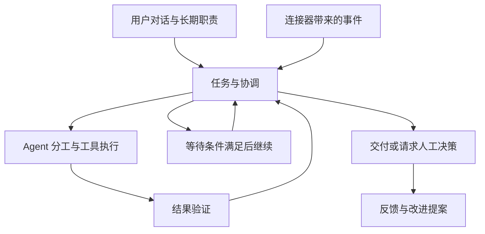
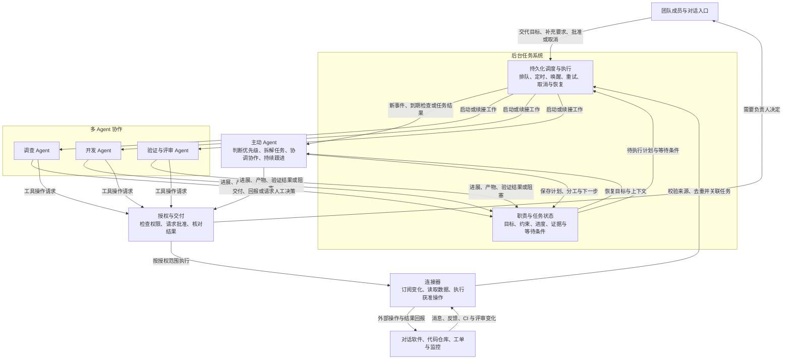

  

<h1 align="center">Oarvia · 同舟</h1>

团队工作空间里的 Super Agent

## 产品定位

Oarvia 承接团队的长期目标，持续关注工作环境中的变化，主动跟进问题，按需组织多个 Agent 协作，把事情推进到可验证的交付。

用户通过对话交代目标、补充要求和作出决定。Oarvia 在后台保存任务进展与等待条件，通过连接器获取事件、调用工具，并在条件满足时继续工作。

团队可以把一项具体任务交给 Oarvia，也可以让它长期负责一类工作。

> 持续维护这个产品。关注 GitHub 和用户反馈渠道，调查有价值的问题，安排修复与验证，跟进评审和发布条件。涉及产品取舍、架构调整或超出授权范围时，带着证据找负责人决定。

首批场景拟面向开源维护者与小型研发团队。任务、职责与协作机制按通用团队工作设计，后续可以扩展到项目推进、客户跟进和业务运营。

## 核心能力

| 能力 | 产品行为 |
| --- | --- |
| 对话协作 | 接收目标、回答进度、纳入补充要求，并向负责人请求必要的决策。 |
| 长期职责 | 保存关注来源、触发条件、完成标准、授权范围和预算，持续接收新工作。 |
| 主动跟进 | 监听事件、截止时间与等待条件，跟进 CI、评审、审批和外部依赖。 |
| 多 Agent 协作 | 根据任务安排调查、实现、验证等分工，管理依赖并汇总交付。 |
| 连接器 | 接入对话软件、代码仓库、工单、监控与执行环境，按权限读取和操作。 |
| 持续执行 | 保存任务状态、执行证据和产物，支持暂停、取消、接管与故障后的恢复。 |
| 结果验证 | 按任务完成标准检查结果，记录仍未解决的问题与需要人工确认的事项。 |
| 复盘改进 | 从执行记录与人工反馈中提出技能、上下文或工具改进，经验证和相应确认后启用。 |

## 工作方式

长期职责明确目标与边界，外部事件产生或续接任务。协调 Agent 维护任务的优先级、约束、下一步和等待条件，执行 Agent 完成具体工作并返回证据。

每件任务需要持续回答五个问题。

- 为什么做这件事，完成标准是什么？
- 谁负责，允许执行到哪一步？
- 已经完成什么，有哪些证据与产物？
- 正在等待什么，下一步何时发生？
- 什么情况下需要负责人介入？

对话、任务和执行会话分别管理。同一任务可以关联多个渠道，新的输入按身份、权限和任务关系续接。任务要求变更后，相关执行与审批需要重新检查。

## 核心架构

主动 Agent 负责决定下一步，多 Agent 团队承担具体执行。后台任务系统保存计划与结果，在事件到达或等待条件满足时唤醒相应 Agent。连接器提供外部事件与操作入口，写入和交付经过授权检查。

| 组成 | 职责 |
| --- | --- |
| 对话与工作空间 | 连接团队成员与 Agent，承接目标、补充要求、进度查询和人工决策。 |
| 连接器与事件接入 | 接收消息、仓库、工单和监控变化，校验来源与权限，去重并关联已有任务。 |
| 职责与任务系统 | 保存长期目标、行动规则、任务状态、完成标准、预算和等待条件。 |
| 协调 Agent | 判断优先级与下一步，分派工作、管理依赖，汇总结果并决定何时请求人工介入。 |
| 执行 Agent 与环境 | 在授权范围内使用工具和隔离环境，完成调查、实现、验证等工作，保存证据与产物。 |
| 持续执行与恢复 | 持久化执行进度，处理排队、等待、唤醒、重试、取消与故障恢复。 |
| 授权与交付 | 执行前检查当前授权与批准范围，核对外部操作结果，按任务标准交付并回报关联渠道。 |
| 记忆、观测与改进 | 记录执行过程和人工反馈，按权限保存项目经验，验证改进提案并维护版本与回退依据。 |

## 用户故事

| 用户 | 希望交给 Oarvia 的工作 | 预期结果 |
| --- | --- | --- |
| 产品维护者 | 持续关注仓库与用户反馈。 | 有效问题进入任务，重复反馈被关联，重要取舍交由负责人决定。 |
| 团队负责人 | 同时推进多个问题。 | Agent 按职责分工，依赖与阻塞可见，最终有统一的交付记录。 |
| 开发者 | 将修复推进到可评审。 | 保存复现步骤、补丁与测试证据，继续处理 CI 和评审意见。 |
| 问题反馈者 | 在原来的渠道获知处理结果。 | 问题有跟进记录，获准公开的结果回报到关联反馈处。 |
| 管理员 | 控制行动范围与资源消耗。 | 可以设置预算、修改授权、暂停职责、取消任务或接管执行。 |

## 品牌

**Oarvia** 由 _oar_（船桨）与 _via_（路径、经由）组合而来，中文名为**同舟**。

Logo 采用中性黑白几何风格，将 O 与 A 融合为一个标记，以斜向留白表达持续前进。标记保存在 [assets/logo.png](assets/logo.png)，为透明底 PNG。README 使用 [白底预览](assets/logo-preview.png)，便于在深浅背景下查看。
